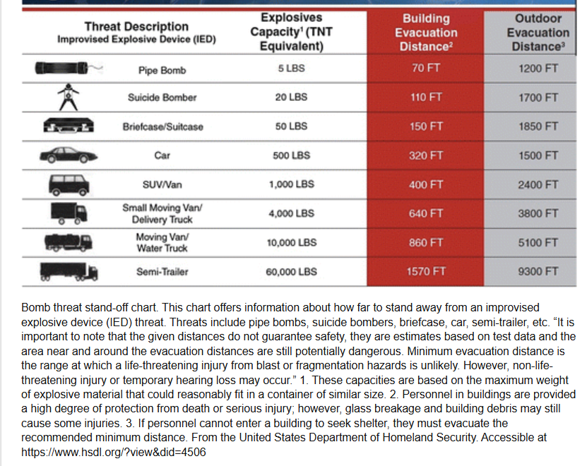

# 🧮 폭약량 및 안전거리 계산기

현장 훈련 시 폭약의 위력과 안전거리를 신속하게 산출하기 위한 도구입니다. **DHS Standoff Chart** 레퍼런스 기능이 포함되어 있습니다.

---

### 1. 입력 모드 선택

  <button onclick="setInputMode('manual')" id="modeManualBtn" style="flex: 1; padding: 10px; background: #e9ecef; border: 1px solid #ced4da; border-radius: 5px; cursor: pointer; font-weight: bold;">🔧 무게 수동 입력 (g)</button>
  <button onclick="setInputMode('reference')" id="modeRefBtn" style="flex: 1; padding: 10px; background: #28a745; color: white; border: 1px solid #28a745; border-radius: 5px; cursor: pointer; font-weight: bold;">📦 용기별 짐작하기 (DHS 기준)</button>

### 2. 폭약 조건 입력

  <label><strong>폭약 종류 선택:</strong></label> 
  <select id="expType" style="width: 100%; padding: 8px; margin: 8px 0 20px 0; border-radius: 5px;">
    <option value="1.00">💣 TNT (RE: 1.00)</option>
    <option value="1.34">🧱 C4 (RE: 1.34)</option>
    <option value="1.25">💥 테트릴 (RE: 1.25)</option>
    <option value="0.92">🧨 다이너마이트 (RE: 0.92)</option>
    <option value="0.82">🍚 ANFO (RE: 0.82)</option>
    <option value="0.50">🔥 흑색화약 (RE: 0.50)</option>
  </select>

  

    <label><strong>폭약 무게 (g):</strong></label> 
    <input type="number" id="weight_g" value="1000" step="10" placeholder="그램(g) 단위로 입력하세요" style="width: 100%; padding: 8px; margin: 8px 0 20px 0; border-radius: 5px;">
  

  

    <label style="color: #495057;"><strong>📦 예상 용기 선택 (DHS Standoff Chart 기준):</strong></label> 
    <select id="containerSelect" style="width: 100%; padding: 8px; margin: 8px 0 10px 0; border-radius: 5px; border: 1px solid #ced4da;">
      <option value="2268">파이프 폭탄 (Pipe Bomb - 약 2,268g / 5lbs)</option>
      <option value="9072">자살폭탄 조끼 (Suicide Bomber - 약 9,072g / 20lbs)</option>
      <option value="22680">서류가방/트렁크 (Briefcase/Suitcase - 약 22,680g / 50lbs)</option>
      <option value="226796">승용차 (Car - 약 226,796g / 500lbs)</option>
      <option value="453592">SUV/승합차 (SUV/Van - 약 453,592g / 1,000lbs)</option>
      <option value="1814368">소형 트럭 (Small Moving Van - 약 1,814,368g / 4,000lbs)</option>
      <option value="4535920">이동식 밴/살수차 (Moving Van/Water Truck - 약 4,535,920g / 10,000lbs)</option>
      <option value="27215520">트레일러 (Semi-Trailer - 약 27,215,520g / 60,000lbs)</option>
    </select>
    
* 선택 시 예상되는 TNT 등가 무게(g)가 자동으로 적용됩니다. * 참고 자료: DHS Bomb Threat Stand-off Chart

  

  <label><strong>상황별 안전 기준 (K-계수) 선택:</strong></label> 
  <select id="kSelect" onchange="toggleCustomBox()" style="width: 100%; padding: 8px; margin: 8px 0 10px 0; border-radius: 5px;">
    <option value="none">선택 안 함 (기본 개활지/인명보호 기준만 확인)</option>
    <option value="15">K=15 (참호 및 지하시설 내부 엄폐 기준)</option>
    <option value="22">K=22 (전술적 부분 엄폐 대피 기준)</option>
    <option value="30">K=30 (유리창 등 파편 발생 우려 구역)</option>
    <option value="custom">⚙️ 상황에 맞게 수동으로 직접 입력</option>
  </select>
  
  <input type="number" id="customK" placeholder="원하는 K값을 숫자로 입력하세요 (예: 12.5)" step="0.1" style="width: 100%; padding: 8px; margin: 0 0 20px 0; border-radius: 5px; display: none;">

  <button onclick="calculateEOD()" style="width: 100%; padding: 12px; margin-top: 10px; background: #28a745; color: white; border: none; border-radius: 5px; font-weight: bold; font-size: 16px; cursor: pointer;">계산하기</button>

### 3. 계산 결과

  
✅ <strong>TNT 환산량 (TNT Equivalent):</strong> 0 g

  
  

  
  
🛡️ <strong>안전 이격 거리 (개활지 작업자, K=18):</strong> 0 m

  
🧍 <strong>안전 이격 거리 (비엄폐 인명보호, K=40):</strong> 0 m

  
  

    🎯 <strong id="customKLabel">선택한 안전 기준:</strong>  
    0 m
  

  
  

  
  

    <strong>💡 적용된 공식</strong> 
    • TNT 환산량 = 폭약무게(Wg) × RE계수 
    • 안전 이격 거리(Dm) = K × ∛(TNT 환산량(g) / 1000)  
    ▶ 현재 적용된 계산식:  
    
  

---

### 4. 참고 자료 (DHS Standoff Chart)

요청하신 DHS Standoff Chart 원본 이미지입니다. 계산기는 이 차트의 파운드(LBS) 단위를 그램(g) 단위로 환산하여 적용합니다.

<!-- 아래가 클릭하면 열리고 닫히는 마법의 버튼입니다 -->

  

    📄 원본 차트 이미지 보기 / 숨기기 (클릭👆)
  

  
  

    <!-- 요원님의 실제 이미지 파일 경로를 아래 src=" " 안에 적어주세요! -->
    
  

 

> **⚠️ 주의사항:** 본 계산기는 훈련 및 참고용입니다. 실제 폭파 작업 시에는 반드시 정식 제원표와 현장 지침을 준수하십시오.